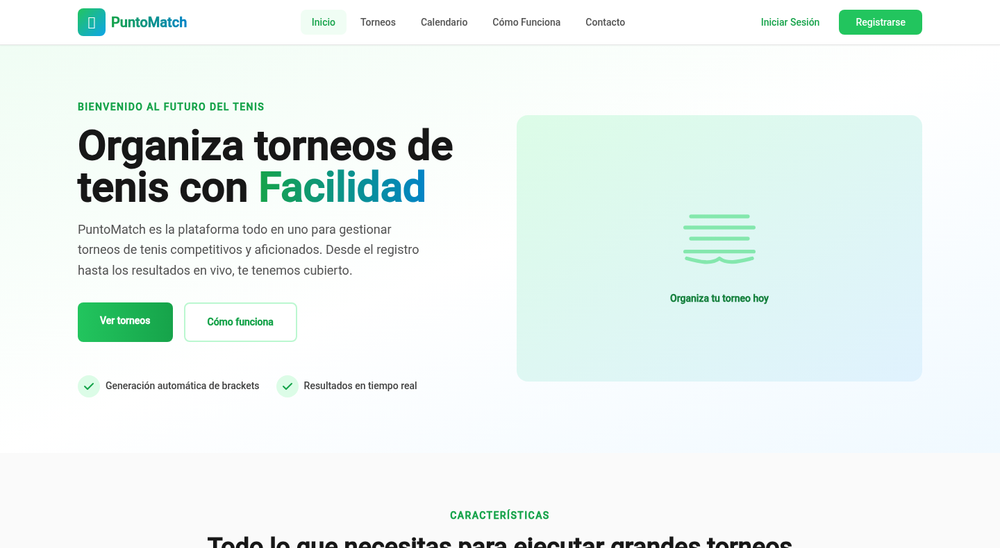
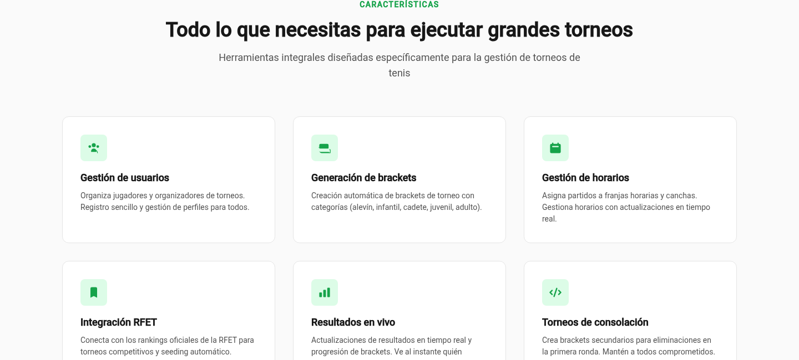
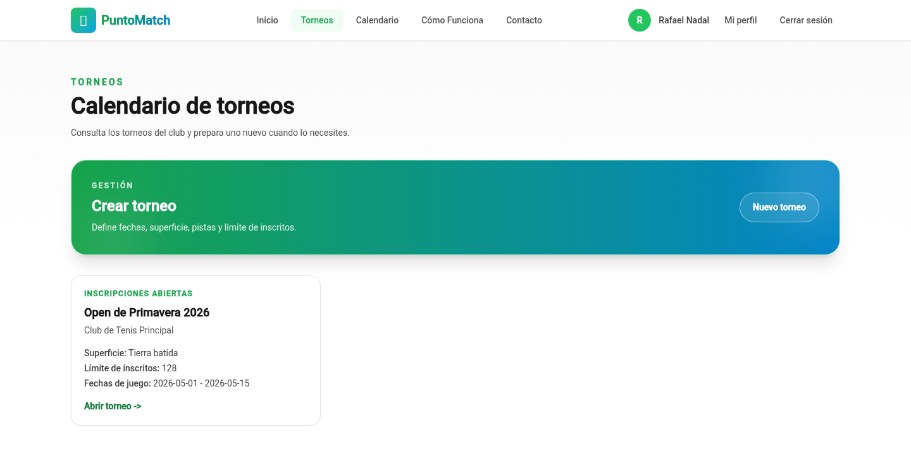
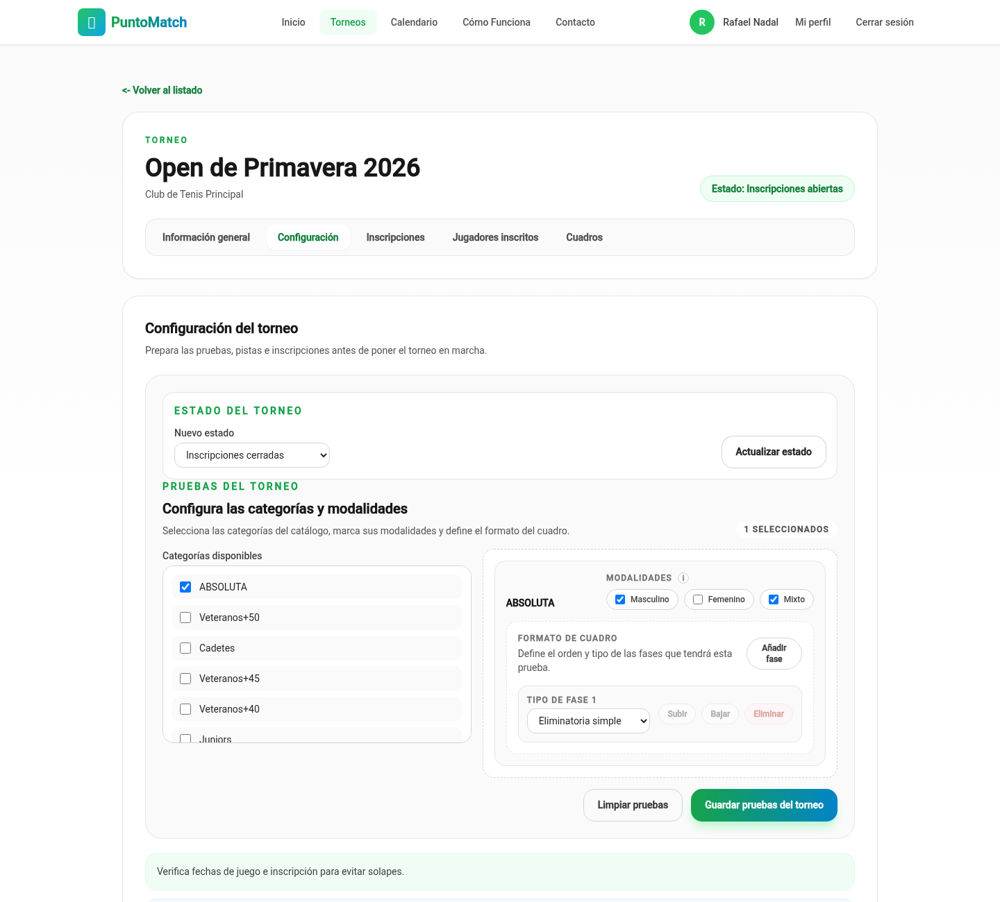
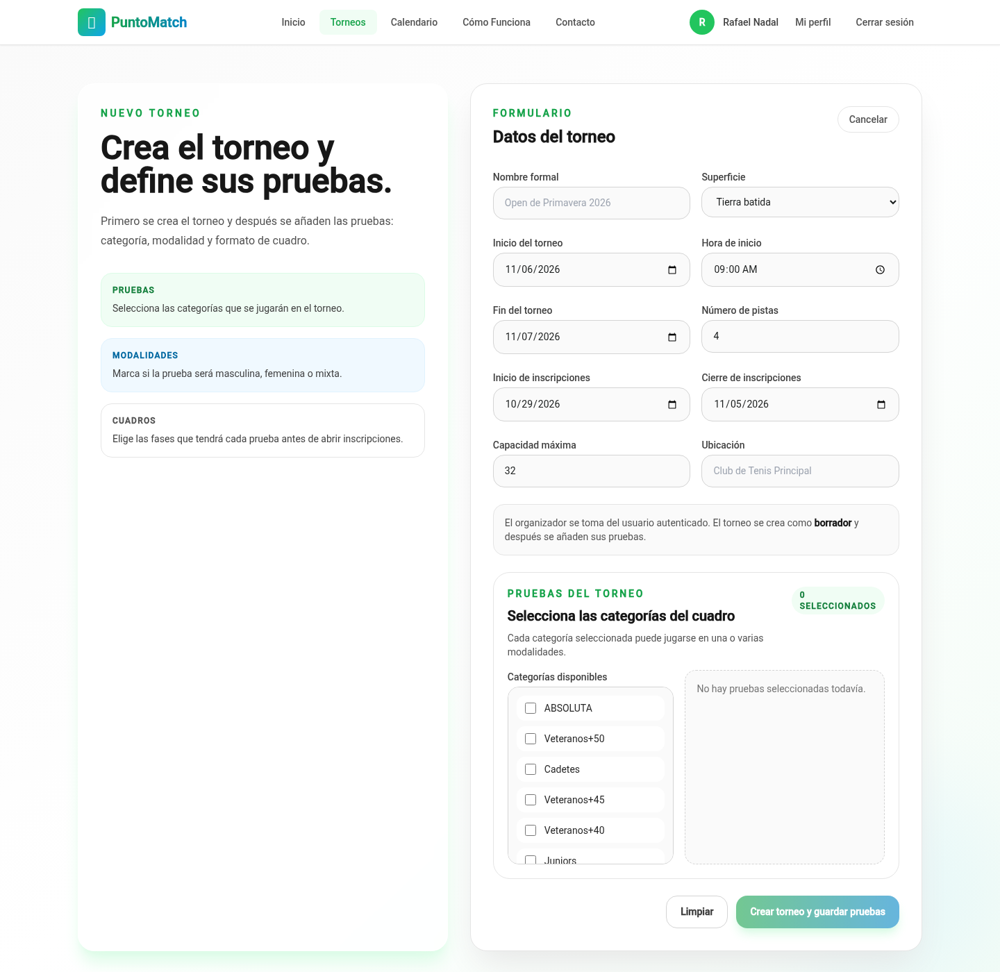
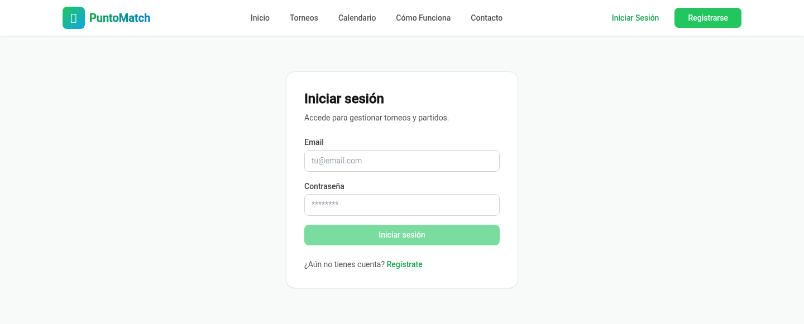
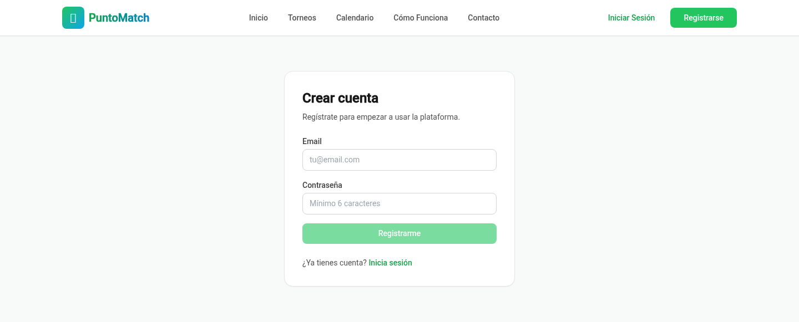

# PuntoMatch

**Every tennis tournament, in one place.**

Spreadsheets, WhatsApp groups, a sign-up sheet taped to the clubhouse door. That is how most tennis
tournaments are still run. **PuntoMatch** replaces all of it with a single, clean workspace where a
club or an organiser can publish a tournament, configure its draws, open inscriptions and schedule
every match on the right court at the right time.

PuntoMatch was presented as a **Master's Final Project (TFM)** for the Master's Degree in
Engineering.



## Why organisers choose PuntoMatch

- **Publish a tournament in minutes.** Name it, pick the surface, set the venue, the courts and the
  dates, say how many players fit. PuntoMatch takes care of the inscription window, the competition
  state and who owns the tournament.
- **Build the whole competition, not just a list.** Choose the categories (absolute, veterans,
  cadets, juniors…), decide whether each one is men's, women's or mixed, and let PuntoMatch generate
  the stages and the single-elimination brackets for you.
- **Schedule it on real courts.** Define the club's courts and assign every match a court and a
  time. Players get their own agenda in the calendar view.
- **Take inscriptions seriously.** Players apply from their account, organisers can register
  participants manually, and professional players can be pulled in from the RFET ranking import.
- **Never lose track of where you are.** Every tournament moves through a clear lifecycle
  (_draft → open → closed → in progress → completed_), and only the transitions that make sense are
  offered. Consolation brackets keep first-round losers playing.
- **Accounts that mean something.** Sign-up with email confirmation, a profile linked to a real
  person (name, nationality, birth date, federation licence) and a JWT session that survives
  refreshes.
- **Made for Spanish tennis.** The whole experience is in Spanish — from the routes to the labels —
  so club staff and players feel at home from the first click.



## Screenshots

| Tournaments list | Tournament detail |
|---|---|
|  |  |

**Create a tournament** — dates, courts, capacity and the categories it will host:



| Sign in | Create an account |
|---|---|
|  |  |

> Screenshots taken from a local run with the sample data shipped in
> `backend/src/main/resources/db/seed/V1000__seed_dev_data.sql`.

## Try it in five minutes

### What you need

| Tool | Version | Notes |
|---|---|---|
| Docker | with Compose v2 | runs PostgreSQL, the API and the Angular app |
| JDK | 25 | only for running the backend outside Docker |
| Node.js | 20.19+ / 22.12+ / 24 | only for running the frontend outside Docker |

### Start everything with Docker

```bash
cp .env.example .env      # adjust secrets if you like
docker compose up --build
```

That brings up:

| Service | URL | Notes |
|---|---|---|
| Frontend | http://localhost:4200 | Angular app served with SSR |
| Backend API | http://localhost:8080/api | Spring Boot |
| PostgreSQL | localhost:5432 | schema created by Flyway migrations |

The template already sets `EMAIL_CONFIRMATION_REQUIRED=false`, so accounts created locally can sign
in without waiting for a confirmation email.

### Or run it from source

```bash
# 1. database only
docker compose up -d postgres

# 2. API (http://localhost:8080)
cd backend
export JAVA_HOME=/path/to/jdk-25
export DATASOURCE_URL=jdbc:postgresql://localhost:5432/demo-tfm
export DB_USER=postgres-tfm
export DB_PASSWORD=secret
export EMAIL_CONFIRMATION_REQUIRED=false
# optional: also load the sample tournament and players
export SPRING_FLYWAY_LOCATIONS='classpath:db/migration,classpath:db/seed'
./mvnw spring-boot:run

# 3. frontend (http://localhost:4200) — reads the API URL from public/config.json
cd frontend
npm install
npm start
```

### Demo accounts

The seed data creates one account per sample player, all with the password `password`:

| Email | Tier |
|---|---|
| `rafa@example.com` | `ADVANCED` |
| `roger@example.com` | `ADVANCED` |
| `serena@example.com` | `ADVANCED` |
| `iga@example.com` | `ADVANCED` |
| `novak@example.com` | `ADVANCED` |
| `coco@example.com` | `INTERMEDIATE` |

Sign in as `rafa@example.com` to find the _Open de Primavera 2026_ tournament already configured
with its categories, stages and draws.

---

## Under the hood

Everything below is for developers and reviewers.

### Stack

| Layer | Stack |
|---|---|
| Backend | Java 25, Spring Boot 4.0, Spring Security (JWT), Spring Data JPA, Flyway, MapStruct, PostgreSQL 18 |
| Frontend | Angular 20 (standalone components, SSR, zoneless change detection), TailwindCSS 3, Angular Material |
| Tooling | Maven wrapper, npm, Docker Compose, Karma + Jasmine, JUnit 5 + Mockito |

```
backend/     Java 25 + Spring Boot API (hexagonal: domain ← application ← infrastructure)
frontend/    Angular 20 SPA with SSR
docs/        architecture, domain model, API spec, coding standards, screenshots
compose.yaml PostgreSQL + API + frontend for local use
```

### Backend

Hexagonal architecture, with the dependency rule `domain ← application ← infrastructure`:

- `domain/port/in/` — use cases, `domain/port/out/` — repository ports
- `application/services/` — `TournamentService`, `AuthService`, `InscriptionService`,
  `MatchGenerationService`, `CalendarService`, `ProPlayerQueryService`…
- `infrastructure/` — REST controllers and DTOs, JPA entities, adapters, mappers, security
- `resources/db/migration/` — Flyway migrations; `resources/db/seed/` — optional sample data

The flow for a new feature is: port out → persistence adapter → service → controller + DTO, mapping
across layer boundaries with MapStruct.

### Frontend

Feature-based standalone components, routed from `frontend/src/app/app.routes.ts`:

| Route | Page |
|---|---|
| `/` | Landing page |
| `/torneos` | Tournament list (requires session) |
| `/torneos/crear` | Tournament creation form with categories, modalities and stages |
| `/torneos/:id` | Tournament detail: overview, configuration, inscriptions, registered players, draws |
| `/calendario` | Calendar of published tournaments and the player's scheduled matches |
| `/perfil` | Complete the player profile |
| `/login`, `/register`, `/confirmar-email` | Authentication and email confirmation |
| `/como-funciona`, `/contacto` | Placeholder pages |

HTTP services live in `app/data/services/`, return `Observable`s and never subscribe internally.
Change detection is zoneless: the views update through signals and the `async` pipe. The API URL is
resolved at runtime from `public/config.json` (or the `API_URL` environment variable when running
SSR in Docker).

### Commands

**Backend**

```bash
./mvnw test
./mvnw test -Dtest=TournamentServiceTest
./mvnw compile
```

**Frontend**

```bash
npm run build              # production build with SSR
npm run test:headless      # single run; `npm test` stays in watch mode
npm run test:ci            # single run with coverage
npm run format             # Prettier
```

`test:headless` and `test:ci` use the `ChromeHeadlessNoSandbox` launcher. Set `CHROME_BIN` if
Chrome is not on `PATH`.

### Documentation

| Document | Content |
|---|---|
| [`docs/architecture.md`](./docs/architecture.md) | Hexagonal backend and frontend layering |
| [`docs/domain-model.md`](./docs/domain-model.md) | Entities, relationships and enums |
| [`docs/api-spec.md`](./docs/api-spec.md) | REST API reference |
| [`docs/coding-standards.md`](./docs/coding-standards.md) | Code conventions |

### Conventions

- **Identifiers in English**; **UI strings, routes and domain vocabulary in Spanish**.
- Backend test methods use **snake_case** (`should_create_tournament_when_found`).
- `@RequiredArgsConstructor` for constructor injection, `@Builder` for domain models, `record` for
  DTOs.
- Frontend: standalone components, dependency injection via `inject()`, zoneless change detection,
  SSR enabled.
- Branches: `develop` is the working branch, `main` is the default. Commits in the imperative mood.

### License

Released under the [MIT License](./LICENSE).
